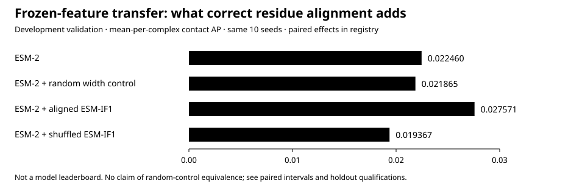

# Antibody–antigen interface research

**From interface localisation to residue-pair correspondence.**

FrameContact and controlled protein-representation experiments: contact maps, epitope/paratope prediction, partner retrieval, and the evidence needed to tell these capabilities apart.

[Results atlas](results/atlas/README.md) · [All branch progress](results/integration_20261007/BRANCH_PROGRESS.md) · [Cohorts](results/atlas/COHORTS.md) · [Reproduce](docs/REPRODUCE_EXACT.md) · [Historical jobs](results/operations/README.md) · [Repository layout](docs/REPOSITORY_LAYOUT.md) · [Preservation](archive/2026-10-07/README.md)

## FrameContact: three endpoints, one documented evaluation

Sequence inputs plus independently predicted intra-chain geometry; **no experimental bound coordinates as model input**. On the checkpoint-aligned **549-case historical test**, fixed routed medians over seeds 17/29/43 are:

| Contact AP | Epitope AP | Paratope AP |
|---:|---:|---:|
| **0.02667** | **0.22031** | **0.69859** |

Mean-per-complex AP, not pooled AP or accuracy. This is **exposed historical evidence**, not a fresh blind or proven sequence-double-cold test; some AF3 predictions use homolog MSAs. [Per-seed results](results/aligned_test549_replay_v1/RESULT.json) · [455/549 split correction](paper/neurips_2026_framecontact/CHECKPOINT_TEST_ALIGNMENT_20260905.md)

## Controlled findings

| Question | Measured answer | Scope |
|---|---|---|
| Does aligned structural information transfer? | ESM-IF1 vs ESM-2: **+0.005111 AP**, 95% CI [0.003780, 0.006439]. Shuffled ESM-IF1: **-0.003093 AP** vs ESM-2. | Ten paired training seeds; development data; intervals resample seeds. [Artifact](results/representation_attribution_v1/report.json) |
| Is the damage only an amino-acid-type mismatch? | Same-AA shuffling: **0.027995 → 0.011100 AP**. Equal-component paired effect **-0.017151**, CI [-0.022688, -0.012434]. | Three fixed seeds; 217 development complexes; crossed seed/component interval. [Readout](extensions/correspondence_v2/READOUT.md) |
| Does the correspondence contrast confirm on held-out data? | **One of two encoders confirms:** ProteinMPNN **+0.003594 AP**; ESM-IF1 **+0.002260**, interval includes zero. | One registered 217-case holdout read; now closed. Not a universal necessity claim. [Both results](results/holdout_confirmation_v1/README.md) |



The random width control is **undecided**, not proven equivalent. The figure and headline metrics are derived from [hashed source artifacts](results/HEADLINE_REGISTRY.json); different seed sets and aggregation units are never pooled into a stronger-looking number.

**Objective ablation:** removing complex-ranking supervision improved both contact and node endpoints in the recorded factorial study. This is an intervention on the full training/selection procedure, not an isolated gradient mechanism. [Ablation and qualifications](results/objective_component_localisation_v1/PART_TWO.md)

## External baseline — measured here, not invented here

The **official RePaRank sequence checkpoint** scores **0.037808 macro pair AP** and **0.008739 pooled pair AP** on **9,638,880 candidate residue pairs** (9,036 contacts) from 217 validation complexes. Its epitope/paratope macro AP is **0.202039 / 0.557707**. [Raw measurement summary](extensions/frontier_multimodel_v1/evidence/reparank_same_protocol_v1/sequence_full/evaluation.json)

This is a pretrained-baseline diagnostic, **not an improvement produced by our model**. Checkpoint training overlap is unknown, and training budgets are not matched. Do not rank it against the 549-case table above.

## Evidence that limits the claims

The complete **122 × 119** partner grid (14,518 distinct pairs; 130,662 repeated evaluations) **did not robustly reproduce** the earlier small-panel MRR increase under corruption. Unobserved pairings are unlabelled alternatives, not verified non-binders. [Full-grid counterevidence](extensions/frontier_multimodel_v1/SCORE_DISSOCIATION_READOUT.md)

On AsEP, ten-seed macro MCC is **0.1572** on `epitope_group` and **0.2584** on `epitope_ratio`; these are not benchmark-leading results. [Benchmark conventions](results/asep_benchmark_v1/BENCHMARK.md) · [Corrections and negative results](docs/CLAIM_BOUNDARIES.md)

## Reproduce without mixing source revisions

**Main now integrates the branch histories and their evidence.** Historical experiments still have different source commits. Divergent runtimes are preserved as source variants or separate namespaces; a combined main checkout is not proof of historical reproduction.

```bash
# Standard-library reporting and preservation checks; no GPU or dataset required.
python3 tools/evidence/verify.py --history

# Prepare the exact experimental source in a NEW detached worktree.
python3 tools/evidence/checkout_experiment.py multimodel ../antibody-multimodel
```

[Exact-source routes and prerequisites](docs/REPRODUCE_EXACT.md) distinguish artifact verification, metric recomputation, and training reproduction. Large datasets, checkpoints, embedding stores and most raw prediction tensors remain outside Git.

## Integrated progress — 7 October 2026

**All 31 starting branch HEADs are included in the integrated Git history**, through 18 explicit three-way merges and their ancestors. Conflicting experimental variants remain preserved; source-specific protocols and checkpoints are not silently made interchangeable. [Every branch and resolution](results/integration_20261007/BRANCH_PROGRESS.md)

| Workstream | Latest committed record | Result boundary |
|---|---|---|
| Structural PLMs | **36/36 tasks complete**, 12 arms | Final decision **NO-PROMOTION** versus matched random-width controls. [Final readout](extensions/frontier_multimodel_v1/STRUCTURAL_PLM_FINAL_READOUT.md) |
| Correctly centered RePaRank structure | **217/217 cases**, 12 reused + 205 fresh | Complete matched-grid diagnostic, not a new model or blind comparison. [Receipt](extensions/frontier_multimodel_v1/evidence/reparank_centered_corrected_v1/evaluation.json) |
| Synthetic rescue and gating | Completed development records | Clean-input cost and calibration shift retained. [Readout](extensions/rescue_qualification_v2/GATED_RESCUE_READOUT.md) |
| Strict retrieval | Infrastructure and separate model-contract implementations integrated | Still protocol/readiness evidence, not a completed strict-model benchmark. [Source separation](extensions/strict_partner_retrieval_v1/README.md) |
| Newer EPIC campaigns | October 4 manuscript reports additional experiments | **Report-only** where matching terminal artifacts were not found in the inspected branch trees; evidence may exist off-Git. [Evidence gaps](results/atlas/REVIEW_FINDINGS.md) |
| AbCite | Separate multimodal evidence-retrieval application | Preserve task-specific protocols and negative holdout-LoRA result. [Application results](abcite/evals/latest.md) |

This is **committed repository progress, not live scheduler status**. Old 12/36 and pending job records remain dated historical snapshots rather than current completion claims. [Historical operations](results/operations/README.md)

Review-related branch names were neutralized before redundant branch references were archived. Their commit histories are unchanged; frozen records retain the names observed at the time. [Rename mapping](results/integration_20261007/BRANCH_RENAMES.json) · [Branch snapshots and restoration](archive/2026-10-07/README.md)

## Nothing discarded to make the front page cleaner

**17 preserved pre-consolidation snapshots · 4,526 distinct path/blob versions · 55,630 tracked-file entries including repetitions.**

Original branch commits, archive tags, failed experiments and superseded interpretations remain available. Redundant active branch references may be pruned only after ancestry and backup verification. [747 evidence-path links](results/ALL_BRANCHES.md) · [Complete tracked-tree inventory](archive/FULL_SNAPSHOT_MANIFEST_20260930.json) · [Offline restore procedure](archive/README.md) · [Full result catalogue](results/INDEX.md)
