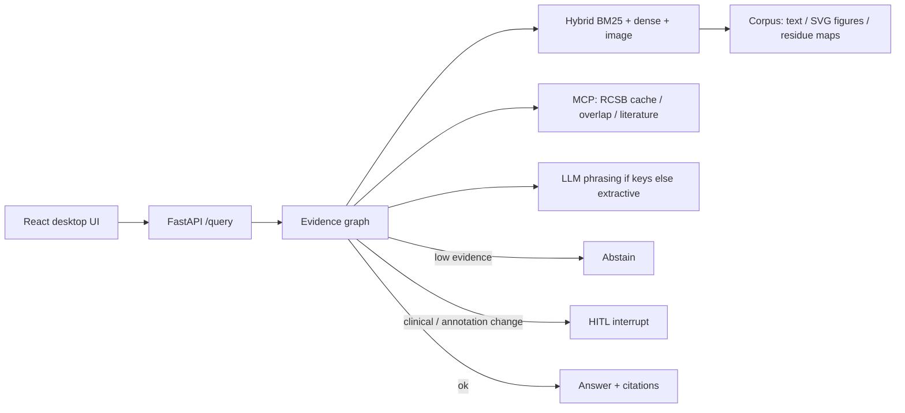

# AbCite — antibody evidence copilot

**Yin Li · 2026-09-09.** Cite-or-abstain RAG over papers, figures, and PDB residue maps. Not a chatbot.

抗体证据副驾驶：问一篇论文声称的 epitope 是否与 PDB / 同一抗原上其他抗体重叠。答案必须引用 chunk；证据不足则弃权；高风险声明走 HITL。

## Problem

Antibody papers often claim epitope overlap without linking residue evidence to a PDB complex or to another antibody on the same antigen. AbCite retrieves **text + figure + structure** chunks, attaches claim-level citations (with thumbnails), and **abstains** when the index cannot support the claim.

FrameContact training code is **not** modified. Public development-validation overlap numbers are cited with their claim boundary (not official test / not SOTA): true epitope Jaccard **0.0566**, a0 predicted top-k Jaccard mean **0.484**.

## Architecture



## 60-second demo

```bash
cd abcite
python3.12 -m venv .venv && source .venv/bin/activate
pip install -e ".[dev]"
python evals/build_corpus.py
pytest
python evals/run.py
python -m uvicorn apps.api.main:app --reload --port 8000
# other terminal
cd apps/web && npm install && npm run dev
# open http://127.0.0.1:5173
```

### Docker Compose

```bash
cd abcite
# API only
docker compose -f infra/compose.yaml up --build api
curl -s http://127.0.0.1:8000/health

# API + web (Vite proxies /query → api:8000)
docker compose -f infra/compose.yaml up --build
# open http://127.0.0.1:5173
```

With keys (not baked into the image): `OPENAI_API_KEY=... docker compose -f infra/compose.yaml up api`

## Eval numbers (`python evals/run.py`, 2026-09-09)

| Metric | Value |
|---|---|
| Gold size | **150** (45 unanswerable / 35 figure-grounded) |
| Abstain-on-unanswerable | **100%** (CI fails if < 100%) |
| Hit@5 (any required chunk) | **99.0%** |
| Recall@5 | **99.0%** |
| Faithfulness (lexical vs cited quotes) | **73.7%** |
| Judge score (heuristic, same formula in CI) | **73.7%** |
| Multimodal citation-id match | **100%** |
| Judge vs human | 10-item seed in `evals/judge_alignment.json` (not a kappa study) |

Source table: [`evals/latest.md`](evals/latest.md).

**CLIP CI:** default GitHub job uses the vendored **tiny CLIP-like** patch projector (`abcite_core/tiny_clip.py`) — no 600MB download. Optional `clip` job sets `ABCITE_CLIP=1`, caches `~/.cache/huggingface`, `continue-on-error: true`. Honest: default green CI is **not** OpenAI CLIP-ViT-B/32.

## Skill coverage (UK Applied AI Engineer)

See [`SKILL_COVERAGE.md`](SKILL_COVERAGE.md).

## Stub vs real in this commit

| Piece | Real now | Still stub / optional |
|---|---|---|
| Hit@5 + lexical faithfulness + judge | yes (`evals/run.py`) | Live LLM judge only with API keys; cache `evals/.cache` |
| Gold | **150** labeled items | Second annotator / Cohen kappa |
| RCSB | allowlist + cache + MCP; live if `ABCITE_RCSB_LIVE=1` | tests never hit the network |
| Vision | local encoder + **tiny CLIP-like** in tests | HF `clip-ViT-B-32` only in optional CI job |
| OpenAI/Azure phrasing | called when keys set; citations from retrieval | needs a real key |
| Azure AI Search | `abcite_core/azure_search.py` hybrid+semantic body; mocked tests | live index needs `AZURE_SEARCH_*` |
| Terraform | `infra/terraform/` RG + Search + OpenAI account | not applied (no subscription in CI) |
| LangSmith | `emit_run` if tracing+key | no hosted project in this repo |
| Compose | `infra/compose.yaml` | not a cloud deploy |

## Tests

`pytest` (33): cite-or-abstain, unanswerable, gold≥150, multimodal, tiny-CLIP NN, HITL, MCP/RCSB, fake OpenAI, Azure Search mock, judge prompt contract, LangSmith, eval gate.

## Security

Do not commit API keys. Copy `.env.example` → `.env`. Red-team cases: `evals/security.md`.
