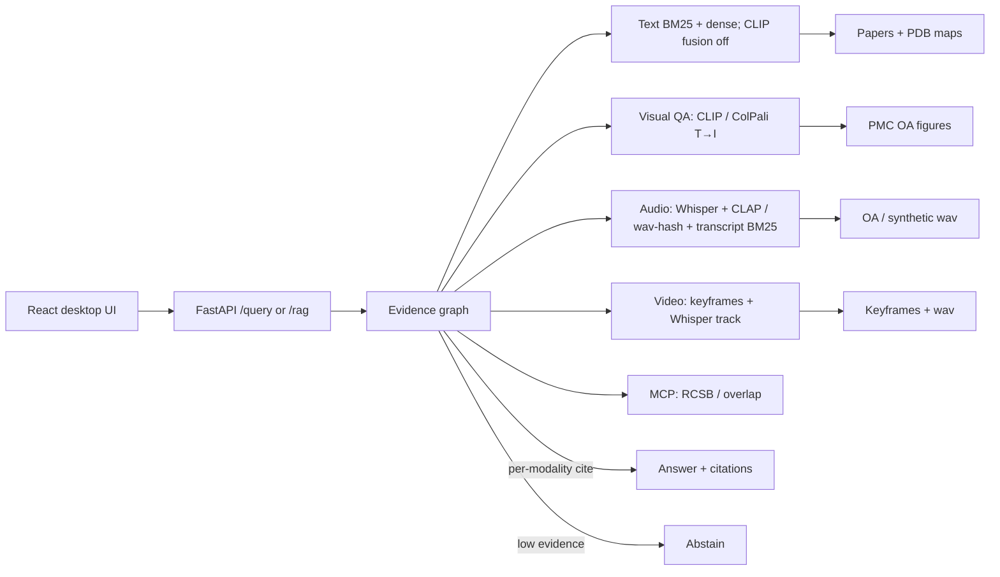

# AbCite — antibody evidence copilot

**Yin Li · 2026-09-10.** Cite-or-abstain **unified multimodal RAG** over papers, figures, audio, video, and PDB residue maps. Not a chatbot.

抗体证据副驾驶：问一篇论文声称的 epitope 是否与 PDB / 同一抗原上其他抗体重叠。答案必须引用 chunk（文本 / 图 / 音频 / 视频）；证据不足则弃权；高风险声明走 HITL。

## Problem

Antibody papers often claim epitope overlap without linking residue evidence to a PDB complex or to another antibody on the same antigen. AbCite retrieves **text + figure + audio + video + structure**, attaches claim-level citations (with thumbnails), and **abstains** when the index cannot support the claim.

FrameContact training code is **not** modified. Public development-validation overlap numbers are cited with their claim boundary (not official test / not SOTA): true epitope Jaccard **0.0566**, a0 predicted top-k Jaccard mean **0.484**.

## Architecture



One `/query` (`/rag` alias) accepts `task=evidence|visual_qa|audio_qa|video_qa|unified` plus optional `image_path` / `audio_path` / `video_path`. **Fusion is within-modality only.** Do not RRF vision into caption BM25 for the text-only protocol (that already hurt).

## 60-second demo

```bash
cd abcite
python3.12 -m venv .venv && source .venv/bin/activate
pip install -e ".[dev]"
# Real CLIP (optional): pip install -e ".[clip]" && python -m abcite_core.download_clip
python evals/build_corpus.py
pytest
python evals/run.py
python evals/download_figures.py --max 16000 --source pmc --workers 12   # OA jpg/png gallery; resume-able
python evals/build_av_fixtures.py                 # tiny committed wav + keyframe fixtures
python evals/run_visual_qa.py --fixture           # visual figure QA on 12 OA jpgs
python evals/run_visual_qa.py                     # visual QA + pixel retrieval (ColPali: --try-colpali)
# 5090, GPU idle: cite-or-abstain VLM (Qwen2-VL-2B-Instruct generate, not ColQwen2 MaxSim)
# ABCITE_VLM=1 python evals/run_visual_qa.py --try-colpali --colpali-only --vlm
# or: bash evals/run_vlm_vqa.sh
python evals/run_vidore.py --suite                # MaxSim ViDoRe v1 (not comparable to 89.2)
python evals/run_vidore_official.py --suite       # vidore-benchmark harness (comparable to 89.2)
python evals/run_audio_qa.py                      # transcript BM25 vs CLAP/hash (synthetic)
python evals/run_audio_qa.py --oa                 # after download_av.py (real Commons)
python evals/run_video_qa.py                      # keyframes vs transcript (synthetic)
python evals/run_video_qa.py --oa
python evals/run_unified.py                       # four-modality snapshot
python evals/run_multimodal.py                    # appendix: held-out caption-as-query + Protocol B
python -m uvicorn apps.api.main:app --reload --port 8000
# other terminal
cd apps/web && npm install && npm run dev
# open http://127.0.0.1:5173
```

### Docker Compose

```bash
cd abcite
# API only
docker compose -f infra/compose.yaml up --build api
curl -s http://127.0.0.1:8000/health

# API + web (Vite proxies /query → api:8000)
docker compose -f infra/compose.yaml up --build
# open http://127.0.0.1:5173
```

With keys (not baked into the image): `OPENAI_API_KEY=... docker compose -f infra/compose.yaml up api`

## Eval numbers (`python evals/run.py`, 2026-09-09)

CI gates **fixture** only (150 in-corpus items). **Hard-dev** is 40 paraphrases / multi-hop / out-of-index / residue questions.

| Metric | Fixture (n=150) | Hard-dev (n=40) |
|---|---|---|
| Gold | 105 answerable + 45 unanswerable (35 figure-grounded) | 30 answerable + 10 out-of-index abstain |
| Abstain-on-unanswerable | **100%** (CI fails if < 100%) | **100%** (unknown PDB / closed-index) |
| Hit@5 | **100.0%** (vanity / in-corpus; CLIP fusion off) | **96.7%** (rewrite; not a 99% target) |
| Recall@5 | 99.5% | 90.0% |
| nDCG@10 | 0.891 | **0.801** |
| MRR | 0.857 | 0.787 |
| Faithfulness (lexical vs cites) | 73.8% | 74.5% |
| Faithfulness (claim-span) | 80.2% | 73.6% |
| Claim-NLI heuristic | 77.2% | 74.6% |
| Judge (lexical heuristic, CI) | 73.8% | 74.5% |
| Multimodal citation-id match | 100% | 90.9% |

By `source` (answerable ranking only): fixture `public_pdb` n=105 Hit@5 100.0% / nDCG@10 0.891 / MRR 0.857. Hard `public_pdb` n=30 Hit@5 96.7% / nDCG@10 0.801 / MRR 0.787. `synthetic_exam` items are unanswerable (no ranking). Fixture Hit@5 went 99%→100% after CLIP fusion was turned **off** — still a closed toy index, not a bar we chased.

Hard auto-taxonomy (all 40): **ok 37**, **miss_multi_hop 2**, **miss_figure 1** — [`evals/traces/hard_taxonomy.json`](evals/traces/hard_taxonomy.json).

CLIP contrast (local hashing encoder in default CI, **14-SVG cite-id demo only**): **image-only** mean rank1−rank2 cosine gap **0.006** on that toy gallery; caption BM25 gap **12.34**; fused RRF gap is small by construction. Self-hit 100% on 14 figures; **not SOTA**. Do **not** call caption-only cite-id “CLIP multimodal”.

**Primary multimodal demo — visual figure QA + pixel retrieval** (2026-09-10). The user question must be answerable only by looking at the image (panel layout, stain, gel bands, colors, arrows, microscopy type). Query is **not** the figure caption. Gold figure is unique; no PDB id in the query. Every answerable item is `caption_bm25_should_fail` (≤1 content-token overlap with the caption). Retrieval is ColQwen2 late-interaction T→I (`vidore/colqwen2-base` + LoRA `vidore/colqwen2-v1.0`). VQA is a separate cite-or-abstain step on the retrieved (or oracle) figure pixels. Product default stays extractive/heuristic. `ABCITE_VLM=1` runs `Qwen/Qwen2-VL-2B-Instruct` generate — not ColQwen2 MaxSim (`custom_text_proj` is retrieval-only). Product: `POST /query` with `task=visual_qa`. CLIP fusion/rerank **off**.

Gold: `evals/gold/visual_qa.jsonl` (**n=182**: 166 unique-gold answerable + 16 abstain; every answerable item is `caption_bm25_should_fail`). All 166 answerable gold IDs are in the 16k gallery. Gallery: **N=15,949** readable PMC OA jpg on the 5090. Encoder: ColQwen2 late-interaction (GPU MaxSim, `Query: ` prefix). OpenCLIP and BiomedCLIP were re-scored on this **same n=166 / N=15,949** gold (npy cache hits; no 16k re-encode).

### Headline: vision beats caption BM25 (fair visual gold)

Four-column on NVIDIA GeForce RTX 5090 (**n=166** / **N=15,949**). ColQwen2: GPU MaxSim (`maxsim GPU n_q=166 n_d=15949`), npz hit (`embeddings-colqwen2-n15949.npz`), `Query: ` prefix, query/doc tokens capped 64/768. OpenCLIP / BiomedCLIP: pooled T→I, `embeddings-clip-vit-b-32-n15949.npy` / `embeddings-biomedclip-n15949.npy` hits. All answerable items are `caption_bm25_should_fail`.

| Column | R@1 | R@5 | R@10 | nDCG@5 |
|---|---|---|---|---|
| caption BM25 | 0.000 | 0.000 | 0.000 | 0.000 |
| BiomedCLIP T→I | 0.042 | 0.078 | 0.102 | 0.060 |
| OpenCLIP ViT-B-32 T→I | 0.018 | 0.072 | 0.102 | 0.048 |
| **ColQwen2 late-interaction T→I** | **0.066** | **0.187** | **0.217** | **0.130** |

ColQwen2 leads every cutoff. vs the previous **n=51** / N=15,949 ColQwen2 receipt **0.078 / 0.176 / 0.196 / 0.124**: R@1 **0.078 → 0.066** (larger, more diverse gold); R@5 **0.176 → 0.187**; R@10 **0.196 → 0.217**; nDCG@5 **0.124 → 0.130**. Same-gold CLIP vs that n=51 reference dropped too (BiomedCLIP R@1 0.059→0.042; OpenCLIP 0.039→0.018). Vision still beats caption BM25 (0). Encoder: `vidore/colqwen2-v1.0` LoRA on local `vidore/colqwen2-base` (offline). Do not score Qwen2-VL-2B as ColPali. Receipt: `evals/visual_qa_latest.json` / `evals/visual_qa_protocols_latest.json`.

N=1,200 n=51 reference (not the headline): ColQwen2 0.196 / 0.353 / 0.373 / 0.283; OpenCLIP 0.176 / 0.314 / 0.333 / 0.247; BiomedCLIP 0.098 / 0.176 / 0.274 / 0.135; BM25 0.020 / 0.039 / 0.059 / 0.029.

VQA cite-or-abstain is **not** retrieval R@K and **not** ViDoRe (official mean **89.11** vs published **89.2**). Heuristic on the new gold (n=182 queries / 166 answerable / 16 abstain, N=15,949, 5090). Product default stays extractive/heuristic (`ABCITE_VLM=0`). Qwen2-VL-2B was **not** re-run.

| Answerer | e2e | oracle-figure | abstain | cite@1 |
|---|---:|---:|---:|---:|
| heuristic pixel cues (n=182 / N=15949) | **11.0%** | **57.7%** | **75%** | 6.6% |
| Qwen2-VL-2B-Instruct generate (prior n=61 receipt; not re-run) | 1.6% | 42.6% | 0% | 7.8% |

The 2B VLM **does not beat** the heuristic on the prior gold. It over-answered (abstain **0%** on 10 unanswerable items). Do not set `ABCITE_VLM_MODEL=vidore/colqwen2-base`. Cached `embeddings-colqwen2-n15949.npz`; no 16k re-encode.

**Not SOTA on the PMC figure protocol.** That nDCG@5 **0.130** is not ViDoRe. ViDoRe is **page retrieval** (visual question → PDF page). AbCite visual QA is **figure-jpg retrieval** on 166 PMC questions over N=15,949. Do not put 0.130 next to 81.3 or 89.2.

### Official ViDoRe v1 (same ColQwen2 weights)

Same cached `vidore/colqwen2-v1.0` on the 5090 (`python evals/run_vidore.py --suite`). Official QA-format Hub subsets, our MaxSim + binary nDCG@5. Page retrieval, not PMC figure visual QA.

| Official task | queries | pages | R@1 | R@5 | R@10 | nDCG@5 |
|---|---:|---:|---:|---:|---:|---:|
| ArxivQA | 500 | 500 | 0.820 | 0.920 | 0.946 | **0.875** |
| DocVQA | 500 | 500 | 0.484 | 0.622 | 0.700 | **0.557** |
| InfoVQA | 500 | 499 | 0.872 | 0.946 | 0.958 | **0.910** |
| TabFQuAD | 280 | 70 | 0.854 | 0.932 | 0.950 | **0.898** |
| TAT-DQA | 831 | 139 | 0.793 | 0.962 | 0.975 | **0.887** |
| ShiftProject | 100 | 83 | 0.780 | 0.830 | 0.830 | **0.810** |
| SyntheticDocQA-AI | 100 | 63 | 0.950 | 0.950 | 0.960 | **0.950** |
| SyntheticDocQA-Energy | 100 | 67 | 0.820 | 0.850 | 0.860 | **0.839** |
| SyntheticDocQA-Gov | 100 | 47 | 0.710 | 0.740 | 0.760 | **0.723** |
| SyntheticDocQA-Health | 100 | 53 | 0.830 | 0.870 | 0.880 | **0.848** |
| **10-task mean** | | | | | | **0.830** |

**Custom MaxSim 10-task mean nDCG@5 = 0.8296 (83.0)** — missing the training-time `Query: ` prefix and official query-dedup scorer. **Not the number to compare to 89.2.**

### Official vidore-benchmark harness (comparable to 89.2)

Same weights, `Query: ` prefix restored, `ViDoReEvaluatorQA` (`python evals/run_vidore_official.py --suite`). 10/10.

| Official task | published ColQwen2 | our nDCG@5 |
|---|---:|---:|
| ArxivQA | 0.880 | **0.878** |
| DocVQA | 0.615 | **0.602** |
| InfoVQA | 0.925 | **0.921** |
| TabFQuAD | 0.890 | **0.896** |
| TAT-DQA | 0.822 | **0.814** |
| ShiftProject | 0.899 | **0.907** |
| SyntheticDocQA-AI | 0.990 | **0.990** |
| SyntheticDocQA-Energy | 0.959 | **0.963** |
| SyntheticDocQA-Gov | 0.955 | **0.959** |
| SyntheticDocQA-Health | 0.988 | **0.983** |
| **10-task mean** | **0.892** | **0.891** |

**Official mean nDCG@5 = 0.8911 (89.11).** vs ColPali paper **81.3** (**+7.81**). vs published ColQwen2-v1.0 **89.2** (**−0.09**). Matches the published recipe to 0.1 nDCG. **Not SOTA** (`sota=false` until mean ≥ 89.2). DocVQA is still the drag (0.602 vs 0.615). Receipt: `evals/vidore_official_latest.json`. Does not change PMC figure visual QA (nDCG@5 **0.130** on n=166).

See `evals/visual_qa_protocols_latest.json` after `python evals/run_visual_qa.py`. Caption-as-query Protocols A/B stay **appendix** — BM25 already wins there and CLIP rerank hurts; that is the wrong product task.

### Audio + video (unified multimodal RAG)

Same cite-or-abstain product. Queries ask about **sound or scene**, not spoken words. RRF is **within-audio** or **within-video** only. CI fixtures are an **honest larger synthetic set** (distinct spectra / hue-coded keyframes; transcripts are generic lecture filler so BM25 should fail). Real Wikimedia Commons clips: `python evals/download_av.py` then `python evals/run_audio_qa.py --oa` / `python evals/run_video_qa.py --oa` (or `evals/run_av_oa.sh` on the 5090 with `ABCITE_CLAP=1 ABCITE_WHISPER=1`). Do not mix OA receipts with the synthetic wav-hash table. Whisper and LAION CLAP are opt-in; default CI uses a shared-space spectral / scene encoder.

Gold: `evals/gold/audio_qa.jsonl` (**n=24**: 20 answerable + 4 abstain) and `evals/gold/video_qa.jsonl` (**n=16**: 12 answerable + 4 abstain). All answerable items are `transcript_bm25_should_fail`.

**Audio** (`python evals/run_audio_qa.py`, wav-hash, N=24 synthetic):

| Column | R@1 | R@5 | R@10 | nDCG@5 |
|---|---|---|---|---|
| transcript BM25 | 0.000 | 0.100 | 0.500 | 0.041 |
| **wav-hash T→A** | **0.350** | **0.700** | **1.000** | **0.546** |
| within-audio RRF | 0.050 | 0.500 | 0.900 | 0.270 |

Embedding **beats transcript BM25** at R@1 (0.350 vs 0.000) on sound-description queries. **Not CLAP / not SOTA.**

**OA Wikimedia audio** (`python evals/download_av.py && ABCITE_CLAP=1 python evals/run_audio_qa.py --oa`, N=9 real wav, 5090, 2026-09-10). Encoder is **LAION CLAP** (`laion/clap-htsat-unfused`) loaded from a complete local snapshot (`~/.cache/huggingface/clap-htsat-unfused`, rsynced to `/workspace/hf-cache/clap-htsat-unfused`; Hub API still 429). 16 kHz wavs are resampled to 48 kHz. Small-n; not SOTA. Do not mix with the synthetic wav-hash table.

| Column | R@1 | R@5 | R@10 | nDCG@5 |
|---|---|---|---|---|
| transcript BM25 | 0.000 | 0.444 | 1.000 | 0.217 |
| **CLAP T→A** | **0.333** | **0.778** | **1.000** | **0.577** |
| within-audio RRF | 0.222 | 0.556 | 1.000 | 0.405 |

CLAP **beats** transcript BM25 at R@1 (0.333 vs 0.000) on this 9-clip Commons set. Prior wav-hash on n=6 was tied with BM25 at R@1 0.167. Receipt: `evals/audio_qa_oa_latest.json`.

**Video** (`python evals/run_video_qa.py`, local-image scene cues, N=16 synthetic keyframes):

| Column | R@1 | R@5 | R@10 | nDCG@5 |
|---|---|---|---|---|
| transcript BM25 | 0.083 | 0.417 | 0.833 | 0.249 |
| **keyframe scene T→I** | **0.583** | **1.000** | **1.000** | **0.830** |
| audio track T→A | 0.083 | 0.417 | 0.833 | 0.246 |
| within-video RRF | 0.250 | 1.000 | 1.000 | 0.624 |

Frames **beat transcript BM25** at R@1 (0.583 vs 0.083) on color/layout queries. Receipts: `evals/audio_qa_latest.json`, `evals/video_qa_latest.json`. `POST /query` `task=audio_qa|video_qa|unified`.

**OA Wikimedia video** (`python evals/download_av.py --video-only && ABCITE_CLAP=1 python evals/run_video_qa.py --oa`, N=10 real keyframes, OpenCLIP ViT-B-32 on the 5090). Grew from 6 clips (PLOS mitosis / neutrophil movies replaced missing Commons titles). Small-n; not SOTA. Several clips have no audio stream; audio-track CLAP R@1 is **0.000**.

| Column | R@1 | R@5 | R@10 | nDCG@5 |
|---|---|---|---|---|
| transcript BM25 | 0.100 | 0.600 | 1.000 | 0.358 |
| **keyframe OpenCLIP T→I** | **0.300** | **0.700** | **1.000** | **0.526** |
| audio track CLAP T→A | 0.000 | 0.700 | 1.000 | 0.329 |
| within-video RRF | 0.400 | 0.700 | 1.000 | 0.536 |

Frames beat BM25 at R@1 (0.300 vs 0.100) on this 10-clip set. vs prior N=6: frame R@1 0.500→0.300 (larger gallery). Receipt: `evals/video_qa_oa_latest.json`.

OpenCLIP ViT-B-32 is the default real path when `[clip]` + weights are present. `ABCITE_CLIP_MODEL=biomedclip` loads cached BiomedCLIP; `ABCITE_BIOMEDCLIP_DOWNLOAD=1` may fetch Hub weights (no download in default CI). Optional ColPali: `pip install -e ".[colpali]"` and `ABCITE_COLPALI=1`. Product retrieval does **not** fuse CLIP unless `ABCITE_VISION_FUSION=1`.

Human labels: **40 items, one annotator**. Cohen’s κ vs a second human is **N/A**. **Human vs machine** (not inter-human): κ vs lexical **0.0**, κ vs claim-NLI **0.0** (automatic judges almost always score ≥0.5).

**Demo (real public PDB):** trastuzumab–HER2 **1N8Z** / Cho et al. Nature 2003 PMID 12610673 — [DOI](https://doi.org/10.1038/nature01392) — [RCSB 1N8Z](https://www.rcsb.org/structure/1N8Z). Receipt: [`evals/traces/demo_1n8z.json`](evals/traces/demo_1n8z.json).

Source tables: [`evals/latest.md`](evals/latest.md). Gaps: [`IMPROVEMENTS.md`](IMPROVEMENTS.md).

**CLIP:** default CI is fast (`ABCITE_CLIP=0`, hashing / tiny fallback). Real OpenCLIP ViT-B-32 is the default encoder after:

```bash
pip install -e ".[clip]"
python -m abcite_core.download_clip
```

SVG figures are rasterized to RGB before CLIP (PIL cannot open SVG). The GitHub `clip` job downloads/caches weights and **fails** if the encoder is not CLIP.

## Appendix — Protocol A held-out caption-as-query (wrong product task)

Caption-as-query is SciMMIR-style pair retrieval: BM25 already wins; CLIP rerank hurts. Kept as a diagnostic, not the demo. Real multimodal eval (OpenCLIP ViT-B-32 + BiomedCLIP, 2026-09-10, RTX 5090). PMC OA gallery: **N=15,949** readable jpg. Captions never enter the image encoder. Product default stays **hybrid text, CLIP fusion OFF, CLIP rerank OFF.**

Split **by PMCID 80/20** (seed=7): **2,491 papers** → 1,993 index / **498 query**. Queries = accession-stripped captions (**n_queries=2,805**). Gallery = full N=15,949.

| Column | R@1 | R@5 | R@10 | note |
|---|---|---|---|---|
| caption BM25 | **0.835** | **0.964** | **0.985** | lexical; duplicate captions keep R@1 off 1.0 |
| BiomedCLIP T→I full-gallery | 0.601 | 0.736 | 0.764 | i2i **0.284**; T→I gap **0.069** |
| OpenCLIP ViT-B-32 T→I | 0.047 | 0.096 | 0.124 | i2i **0.081**; T→I gap **0.007** |
| **rerank-on-BM25-top50 (BiomedCLIP)** | 0.661 | 0.815 | 0.851 | **hurts BM25** (ΔR@1 **−0.174**) |

See `evals/multimodal_caption_latest.json`.

## Appendix — Protocol B unique-gold visual questions (small-n)

n_queries=**33**. Caption-free visual gold remapped to `pmc-*`. Not mixed with Protocol A. Rerank still hurts BM25.

| Column | R@1 | R@5 | R@10 |
|---|---|---|---|
| caption BM25 | **0.576** | **0.818** | **0.849** |
| BiomedCLIP T→I | 0.091 | 0.212 | 0.242 |
| OpenCLIP T→I | 0.030 | 0.091 | 0.121 |
| rerank-on-BM25-top50 (BiomedCLIP) | 0.242 | 0.394 | 0.455 |

See `evals/multimodal_visual_latest.json`.

## Skill coverage (UK Applied AI Engineer)

See [`SKILL_COVERAGE.md`](SKILL_COVERAGE.md).

## Stub vs real in this commit

| Piece | Real now | Still stub / optional |
|---|---|---|
| Hit@5 + lexical faithfulness + judge | yes (`evals/run.py`) | Live LLM judge only with API keys; cache `evals/.cache` |
| Gold | **150 fixture** + **40 hard-dev** | Inter-human Cohen κ (one annotator; human-vs-machine κ = 0.0) |
| RCSB | allowlist + cache + MCP; live if `ABCITE_RCSB_LIVE=1` | tests never hit the network |
| Vision | SVG→RGB raster + OpenCLIP when `[clip]` is installed; 15,949 PMC OA figures on GPU; **visual QA** (`task=visual_qa`) is the primary figure demo; CLIP fusion **off** by default; VLM generate is opt-in (`ABCITE_VLM=1`, Qwen2-VL-2B-Instruct) | default CI hashing/tiny (`ABCITE_CLIP=0`); four-column n=166 / N=15,949: ColQwen2 R@1 **0.066**, BiomedCLIP **0.042**, OpenCLIP **0.018**, BM25 0; heuristic VQA e2e **11.0%** / oracle **57.7%** / abstain **75%**; prior 2B VLM n=61 e2e **1.6%** (not re-run; does not beat heuristic) |
| Audio / video | Whisper interface + CLAP/wav-hash + transcript BM25; video = keyframes + audio track; `/query` `task=audio_qa\|video_qa\|unified`; OA Commons path `evals/download_av.py` + `--oa` | OA CLAP encoder=`clap` N=9 R@1 **0.333** vs BM25 0; CI uses synthetic wav/PNG fixtures; OA media is gitignored |
| OpenAI/Azure phrasing | called when keys set; citations from retrieval | needs a real key |
| Azure AI Search | `abcite_core/azure_search.py` hybrid+semantic body; mocked tests | live index needs `AZURE_SEARCH_*` |
| Terraform | `infra/terraform/` RG + Search + OpenAI account | not applied (no subscription in CI) |
| LangSmith | `emit_run` if tracing+key | no hosted project in this repo |
| Compose | `infra/compose.yaml` | not a cloud deploy |

## Tests

`pytest` (40+ + live CLIP skip-if-no-weights): cite-or-abstain, unanswerable, fixture≥150 + hard≥35, multimodal, **visual figure QA** on 12 OA jpgs, **VLM VQA parse / PDB-free query / heuristic default**, **audio QA** + **video QA** synthetic fixtures, caption-as-query appendix, paper holdout, vision rerank top-K, fusion off by default, SVG raster, tiny-CLIP NN, HITL, MCP/RCSB, fake OpenAI, Azure Search mock, judge prompt contract, LangSmith, eval gate.

## Security

Do not commit API keys. Copy `.env.example` → `.env`. Red-team cases: `evals/security.md`.
