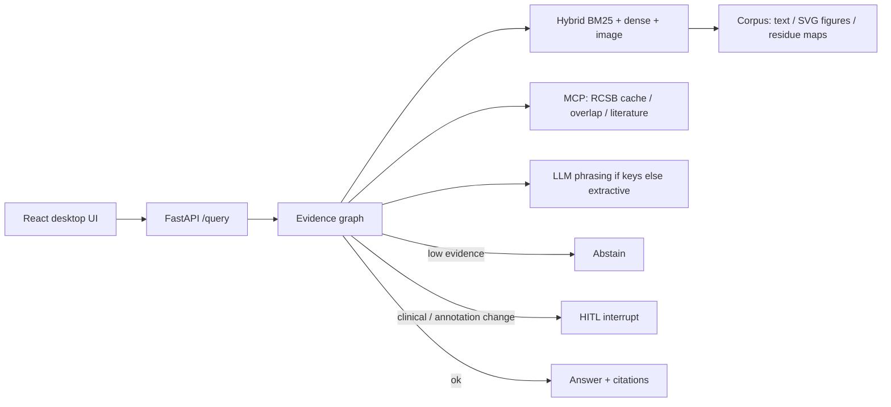

# AbCite — antibody evidence copilot

**Yin Li · 2026-09-09.** Cite-or-abstain RAG over papers, figures, and PDB residue maps. Not a chatbot.

抗体证据副驾驶：问一篇论文声称的 epitope 是否与 PDB / 同一抗原上其他抗体重叠。答案必须引用 chunk；证据不足则弃权；高风险声明走 HITL。

## Problem

Antibody papers often claim epitope overlap without linking residue evidence to a PDB complex or to another antibody on the same antigen. AbCite retrieves **text + figure + structure** chunks, attaches claim-level citations (with thumbnails), and **abstains** when the index cannot support the claim.

FrameContact training code is **not** modified. Public development-validation overlap numbers are cited with their claim boundary (not official test / not SOTA): true epitope Jaccard **0.0566**, a0 predicted top-k Jaccard mean **0.484**.

## Architecture



## 60-second demo

```bash
cd abcite
python3.12 -m venv .venv && source .venv/bin/activate
pip install -e ".[dev]"
python evals/build_corpus.py
pytest
python evals/run.py
python -m uvicorn apps.api.main:app --reload --port 8000
# other terminal
cd apps/web && npm install && npm run dev
# open http://127.0.0.1:5173
```

### Docker Compose

```bash
cd abcite
# API only
docker compose -f infra/compose.yaml up --build api
curl -s http://127.0.0.1:8000/health

# API + web (Vite proxies /query → api:8000)
docker compose -f infra/compose.yaml up --build
# open http://127.0.0.1:5173
```

With keys (not baked into the image): `OPENAI_API_KEY=... docker compose -f infra/compose.yaml up api`

## Eval numbers (`python evals/run.py`, 2026-09-09)

| Metric | Value |
|---|---|
| Gold size | **90** (schema ready for 150; 30 unanswerable / 20 figure-grounded) |
| Abstain-on-unanswerable | **100%** (CI fails if < 100%) |
| Hit@5 (any required chunk) | **98.3%** |
| Recall@5 | **98.3%** |
| Faithfulness (lexical vs cited quotes) | **73.7%** |
| Multimodal citation-id match | **100%** |
| Judge vs human | still unlabeled (`evals/judge_alignment.json`) |

Source table: [`evals/latest.md`](evals/latest.md).

## Skill coverage (UK Applied AI Engineer)

See [`SKILL_COVERAGE.md`](SKILL_COVERAGE.md).

## Stub vs real in this commit

| Piece | Real now | Still stub / optional |
|---|---|---|
| Hit@5 + faithfulness + multimodal cite-id | yes, printed by `evals/run.py` | LLM-as-judge / RAGAS not run |
| Gold | 90 labeled items | 150 target; generator in `evals/more_items.py` |
| RCSB | allowlist + on-disk cache + MCP; live HTTP if `ABCITE_RCSB_LIVE=1` | tests never hit the network |
| Vision | local 256-d image encoder used in RRF; figure-only + image-NN tests | CLIP weights not downloaded in CI |
| OpenAI/Azure phrasing | called when keys set; citations still from retrieval | needs a real key for live phrasing |
| LangSmith | `emit_run` POSTs if `LANGSMITH_TRACING` + key; no crash if off | no hosted project in this repo |
| Compose | `infra/compose.yaml` API + web with `PROXY_API` | not a cloud deploy |
| Azure | `providers/azure.py` + [`infra/azure.md`](infra/azure.md) | Terraform is a note, not a subscription |
| LangGraph compile | optional extra | default is in-process `EvidenceGraph` |

## Tests

`pytest` (21): cite-or-abstain, unanswerable, multimodal `fig-1n8z`, figure-only retrieval, image NN, HITL, MCP/RCSB cache, fake OpenAI HTTP, LangSmith emit, eval gate.

## Security

Do not commit API keys. Copy `.env.example` → `.env`. Red-team cases: `evals/security.md`.
