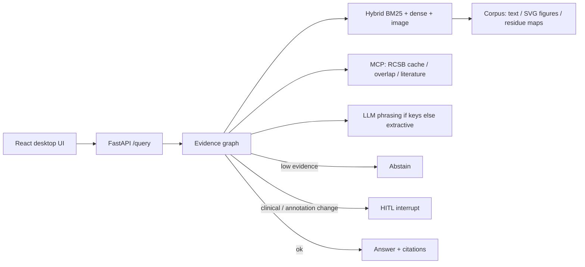

# AbCite — antibody evidence copilot

**Yin Li · 2026-09-09.** Cite-or-abstain RAG over papers, figures, and PDB residue maps. Not a chatbot.

抗体证据副驾驶：问一篇论文声称的 epitope 是否与 PDB / 同一抗原上其他抗体重叠。答案必须引用 chunk；证据不足则弃权；高风险声明走 HITL。

## Problem

Antibody papers often claim epitope overlap without linking residue evidence to a PDB complex or to another antibody on the same antigen. AbCite retrieves **text + figure + structure** chunks, attaches claim-level citations (with thumbnails), and **abstains** when the index cannot support the claim.

FrameContact training code is **not** modified. Public development-validation overlap numbers are cited with their claim boundary (not official test / not SOTA): true epitope Jaccard **0.0566**, a0 predicted top-k Jaccard mean **0.484**.

## Architecture



## 60-second demo

```bash
cd abcite
python3.12 -m venv .venv && source .venv/bin/activate
pip install -e ".[dev]"
# Real CLIP (optional): pip install -e ".[clip]" && python -m abcite_core.download_clip
python evals/build_corpus.py
pytest
python evals/run.py
python evals/download_figures.py --max 1200   # OA jpg/png gallery; resume-able
python evals/run_multimodal.py                 # caption BM25 vs CLIP image-only vs fusion
python -m uvicorn apps.api.main:app --reload --port 8000
# other terminal
cd apps/web && npm install && npm run dev
# open http://127.0.0.1:5173
```

### Docker Compose

```bash
cd abcite
# API only
docker compose -f infra/compose.yaml up --build api
curl -s http://127.0.0.1:8000/health

# API + web (Vite proxies /query → api:8000)
docker compose -f infra/compose.yaml up --build
# open http://127.0.0.1:5173
```

With keys (not baked into the image): `OPENAI_API_KEY=... docker compose -f infra/compose.yaml up api`

## Eval numbers (`python evals/run.py`, 2026-09-09)

CI gates **fixture** only (150 in-corpus items). **Hard-dev** is 40 paraphrases / multi-hop / out-of-index / residue questions.

| Metric | Fixture (n=150) | Hard-dev (n=40) |
|---|---|---|
| Gold | 105 answerable + 45 unanswerable (35 figure-grounded) | 30 answerable + 10 out-of-index abstain |
| Abstain-on-unanswerable | **100%** (CI fails if < 100%) | **100%** (unknown PDB / closed-index) |
| Hit@5 | **99.0%** (vanity / in-corpus) | **96.7%** (rewrite; not a 99% target) |
| Recall@5 | 98.6% | 93.3% |
| nDCG@10 | 0.899 | **0.809** (was 0.652 before rewrite/caption fusion) |
| MRR | 0.866 | 0.798 |
| Faithfulness (lexical vs cites) | 73.7% | 73.7% |
| Faithfulness (claim-span) | 80.4% | 73.0% |
| Claim-NLI heuristic | 77.5% | 74.2% |
| Judge (lexical heuristic, CI) | 73.7% | 73.7% |
| Multimodal citation-id match | 100% | 90.9% |

By `source` (answerable ranking only): fixture `public_pdb` n=105 Hit@5 99.0% / nDCG@10 0.899 / MRR 0.866. Hard `public_pdb` n=30 Hit@5 96.7% / nDCG@10 0.809 / MRR 0.798. `synthetic_exam` items are unanswerable (no ranking).

Hard auto-taxonomy (all 40): **ok 38**, **miss_multi_hop 1**, **miss_figure 1** — [`evals/traces/hard_taxonomy.json`](evals/traces/hard_taxonomy.json).

CLIP contrast (local hashing encoder in default CI, **14-SVG cite-id demo only**): **image-only** mean rank1−rank2 cosine gap **0.006** on that toy gallery; caption BM25 gap **12.34**; fused RRF gap is small by construction. Self-hit 100% on 14 figures; **not SOTA**. Do **not** call caption-only cite-id “CLIP multimodal”.

**Real multimodal protocol** (OpenCLIP ViT-B-32, 2026-09-09, **74 real PMC OA jpg** — not 14 SVGs). Queries are visual content (no PDB ids). Captions held out of the image encoder. Three columns:

| Column | R@1 | R@5 | R@10 | mean rank1−2 gap |
|---|---|---|---|---|
| caption BM25 | 0.047 | 0.109 | 0.156 | (lexical) |
| **CLIP image-only** | **0.016** | **0.125** | **0.188** | i2i **0.162** (was 0.006 on 14 SVGs); T→I gap **0.0036** still collapsed |
| fusion (RRF) | 0.031 | 0.078 | 0.141 | — |

This is **not** SciMMIR CLIP-FT Hits@10 ~13.5% and **not** BiomedCLIP PMC R@1 ~56% (those galleries are 10⁵–10⁶). Zero-shot CLIP T→I on generic panel queries remains weak; i2i gap on real photos is no longer the 14-SVG 0.006 artifact. BiomedCLIP weights were **not in cache** (skipped, no download). Gallery <1000 in this environment: `python evals/download_figures.py --max 1200 --source pmc` (resume-able NCBI OA). Committed fixture is 12 OA jpgs for pytest only. Do **not** call caption-only cite-id “CLIP multimodal”. See `evals/multimodal_visual_latest.json`.

OpenCLIP ViT-B-32 is the real path when `[clip]` + weights are present. `ABCITE_CLIP_MODEL=biomedclip` loads only if weights are already in cache; otherwise **skipped** (no download).

Human labels: **40 items, one annotator**. Cohen’s κ vs a second human is **N/A**. **Human vs machine** (not inter-human): κ vs lexical **0.0**, κ vs claim-NLI **0.0** (automatic judges almost always score ≥0.5).

**Demo (real public PDB):** trastuzumab–HER2 **1N8Z** / Cho et al. Nature 2003 PMID 12610673 — [DOI](https://doi.org/10.1038/nature01392) — [RCSB 1N8Z](https://www.rcsb.org/structure/1N8Z). Receipt: [`evals/traces/demo_1n8z.json`](evals/traces/demo_1n8z.json).

**Demo (real public PDB):** trastuzumab–HER2 **1N8Z** / Cho et al. Nature 2003 PMID 12610673 — [DOI](https://doi.org/10.1038/nature01392) — [RCSB 1N8Z](https://www.rcsb.org/structure/1N8Z). Receipt: [`evals/traces/demo_1n8z.json`](evals/traces/demo_1n8z.json).

Source tables: [`evals/latest.md`](evals/latest.md). Gaps: [`IMPROVEMENTS.md`](IMPROVEMENTS.md).

**CLIP:** default CI is fast (`ABCITE_CLIP=0`, hashing / tiny fallback). Real OpenCLIP ViT-B-32 is the default encoder after:

```bash
pip install -e ".[clip]"
python -m abcite_core.download_clip
```

SVG figures are rasterized to RGB before CLIP (PIL cannot open SVG). The GitHub `clip` job downloads/caches weights and **fails** if the encoder is not CLIP.

## Skill coverage (UK Applied AI Engineer)

See [`SKILL_COVERAGE.md`](SKILL_COVERAGE.md).

## Stub vs real in this commit

| Piece | Real now | Still stub / optional |
|---|---|---|
| Hit@5 + lexical faithfulness + judge | yes (`evals/run.py`) | Live LLM judge only with API keys; cache `evals/.cache` |
| Gold | **150 fixture** + **40 hard-dev** | Inter-human Cohen κ (one annotator; human-vs-machine κ = 0.0) |
| RCSB | allowlist + cache + MCP; live if `ABCITE_RCSB_LIVE=1` | tests never hit the network |
| Vision | SVG→RGB raster + OpenCLIP ViT-B-32 when `[clip]` is installed | default CI uses hashing/tiny (`ABCITE_CLIP=0`); BiomedCLIP **skipped** unless cached weights exist |
| OpenAI/Azure phrasing | called when keys set; citations from retrieval | needs a real key |
| Azure AI Search | `abcite_core/azure_search.py` hybrid+semantic body; mocked tests | live index needs `AZURE_SEARCH_*` |
| Terraform | `infra/terraform/` RG + Search + OpenAI account | not applied (no subscription in CI) |
| LangSmith | `emit_run` if tracing+key | no hosted project in this repo |
| Compose | `infra/compose.yaml` | not a cloud deploy |

## Tests

`pytest` (40+ + live CLIP skip-if-no-weights): cite-or-abstain, unanswerable, fixture≥150 + hard≥35, multimodal, SVG raster, tiny-CLIP NN, HITL, MCP/RCSB, fake OpenAI, Azure Search mock, judge prompt contract, LangSmith, eval gate (fixture vs hard, CLIP caption fusion, human-vs-machine κ, hard taxonomy n=40).

## Security

Do not commit API keys. Copy `.env.example` → `.env`. Red-team cases: `evals/security.md`.
