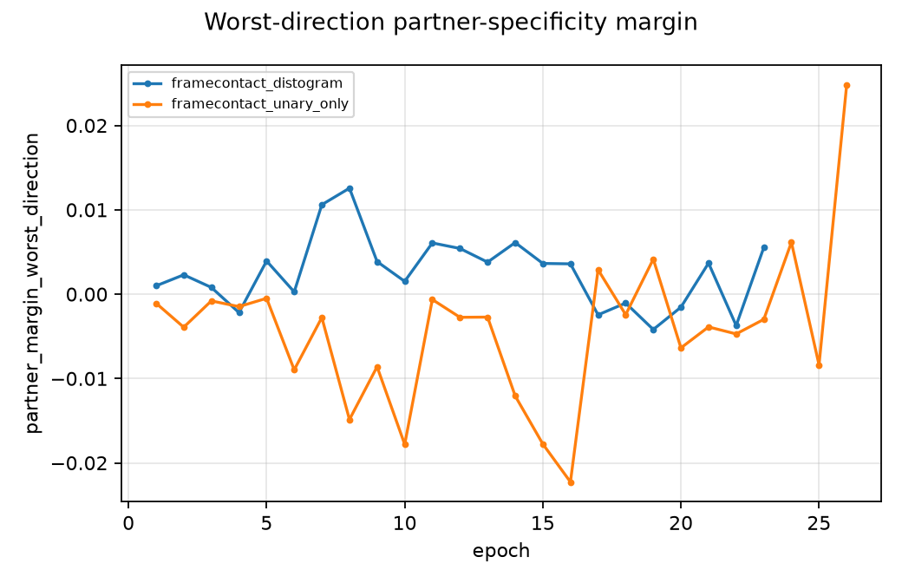

# Partner specificity: an identifiable channel, and why the current metric cannot decide anything

**Date:** 2026-08-02
**Scope:** SAbDab2 antigen-fold development validation only. No frozen test and no AsEP official test was read.
**Companion artifacts:** [`reports/decision-v1-20260802`](decision-v1-20260802), [`protocols/framecontact_specificity_gauge_exploratory_v1.json`](../protocols/framecontact_specificity_gauge_exploratory_v1.json)

## 1. Summary

Two findings, both from the code and the live runs rather than from new experiments.

**Finding A. The contact-derived residue evidence contains a partner-agnostic term, and the partner-specificity score is not a well-defined quantity.**
The contact logit map decomposes as an antibody profile plus an antigen profile plus a jointly dependent remainder. Only the remainder can distinguish partners. The residue heads currently in flight marginalize the *full* contact map, so their contact evidence still carries both single-chain profiles, which are identical for every candidate partner. Worse, that decomposition is not unique until a gauge is fixed, so the `interaction_only` score the project trains and selects on is gauge dependent and not comparable across pair heads. This is now fixed, measured, and testable.

**Finding B. The worst-direction partner margin moves further between neighbouring epochs of one run than it does between arms, and the headline negative result is an artifact of the epoch it was read at.**
Across the two live arrays the margin changes by 0.0131 (unary) and 0.0102 (distogram) per epoch on average, changes sign up to 13 times in 25 epochs, and the distogram-minus-unary mean delta flips sign six times over 21 epochs. Epoch 19, the epoch the master ledger reports, is the single most negative epoch in the whole trajectory. At 18 of the 21 available epochs the same comparison has the opposite sign.

The practical consequence: **the current checkpoint-selection rule selects on noise**, and no conclusion about partner specificity — positive or negative — can be drawn from a single epoch.

## 2. Finding A in detail

### 2.1 The contact map has a partner-agnostic part, and the residue head consumes it

`PairContactHead.components` builds

```
contact_logits[i, j] = interaction[i, j] + antibody_unary[i] + antigen_unary[j] + bias
```

and its own docstring states that the unary terms "must not be allowed to establish partner specificity by themselves". The specificity *loss* respects this and scores `interaction_only`. The residue heads do not:

```1397:1398:src/interaction_first/framecontact.py
        paratope_contact = marginalizer(contact_logits, pair_mask, dim=2)
        epitope_contact = marginalizer(contact_logits, pair_mask, dim=1)
```

Marginalizing the full map over the antibody axis leaves `antigen_unary[j]` as an additive constant on every antigen residue. That term is computed from the antigen alone and is bit-identical for the cognate partner and for every decoy partner. So the `contact_marginal_only` and `gated_hybrid` heads route a partner-agnostic signal into the prediction whose partner dependence is the thing being measured.

### 2.2 The decomposition is not unique, so the specificity score is not either

`interaction[i, j] = q_i · k_j / sqrt(d)` is unconstrained. It can absorb any profile of the form `a_i + b_j` without changing `contact_logits`. Two models with identical contact predictions can therefore report arbitrarily different `interaction_only` specificity scores. Nothing in the current code pins this down.

### 2.3 The distogram makes it worse, and confounds the comparison the teacher asked for

For `PairDistogramHead`, `interaction_logits` is `logsumexp` over near bins minus `logsumexp` over far bins of the *interaction-only* per-bin logits. Because that collapse is nonlinear, the result is **not an additive component of `contact_logits` at all**. So under `specificity_score_source="interaction_only"`, the partner margin measures one thing for the binary head and a different thing for the distogram head.

This matters directly: the binary-versus-distogram partner-margin comparison — teacher question 2 — is confounded in the metric itself, independently of the model. The decision report now carries this as an explicit caveat on that phase.

### 2.4 The fix: a gauge-fixed, head-agnostic specificity channel

[`src/interaction_first/contact_gauge.py`](../src/interaction_first/contact_gauge.py) applies the two-way additive-effects (ANOVA) projection to the **final** contact logits:

```
contact_logits = grand + antibody_effect[i] + antigen_effect[j] + interaction[i, j]
```

with `interaction` constrained to zero masked row means and zero masked column means. Properties, all covered by tests:

| Property | Measured | Consequence |
|---|---|---|
| Reconstruction is exact for any mask | 4e-16 | Enabling the gauge never changes the contact prediction |
| Unique under the centering constraint | residual 1e-16 (padded) | The specificity channel stops being gauge dependent |
| Applied to final logits | — | Binary and distogram heads become comparable on the same footing |
| Channels orthogonal for padded-rectangular masks | gap 3e-16 | Variance splits exactly into three shares |
| Zero for additively separable maps | 4.03e-15 | The degenerate partner-agnostic solution is detectable |

That last row is the point. A model whose contact map is just "antibody propensity plus antigen propensity" is the degenerate partner-agnostic solution, and until now nothing in the project could detect it. **`partner_specific_share` reads zero for it**, and is logged every epoch.

One caveat found while verifying this, and now guarded. The exactness above holds for *padded-rectangular* masks — the production case, since `pair_mask` is an antibody-mask by antigen-mask outer product. When a `pair_candidate_mask` is supplied the mask becomes genuinely ragged, single-pass centering leaves a residual of order 1e-1, and the alternating projection that fixes the centering costs orthogonality: the channel variances then miss the observed variance by up to 3%. That case is not hypothetical — it is exactly the CDR-by-patch mask of the phase-3 triangle arm. The attribution therefore now reports `partition_gap`, the relative discrepancy between the channel variances and the observed variance, alongside the existing centering residual, and the trainer logs both per epoch. The shares are trustworthy only while that gap is negligible.

Because the interaction channel is centered along the axis being marginalized, the gauge-routed residue marginal is nonnegative and is exactly zero for a flat profile. It measures how *concentrated* the partner-specific evidence is at a residue, not how large the map is.

### 2.5 Residue-level partner supervision

The specificity loss currently supervises one scalar per complex: the mean sigmoid of the top 1% of the pair map. That is very little signal for a property measured per residue. `residue_partner_contrastive_loss` adds the requirement the evaluation actually tests: at every labelled interface residue, the logit computed against the cognate partner must beat the logit computed against each decoy by a margin. The paratope side uses wrong-antigen decoys and the epitope side uses wrong-antibody decoys, so the residue axis stays aligned with the labels.

## 3. Finding B in detail

Measured on the live logs of jobs 1345042 and 1345108, five seeds each.

| Arm | Epochs so far | Mean per-epoch change in margin | Sign changes per seed | Observed range |
|---|---:|---:|---|---|
| `framecontact_unary_only` | 26 | 0.013094 | 2 to 13 | −0.0552 to +0.0443 |
| `framecontact_distogram` | 23 | 0.010152 | 5 to 10 | −0.0245 to +0.0346 |

The distogram-minus-unary mean delta, over the 21 epochs both arrays have reached. The rows below are the three largest positive, all three negative, and the latest; the per-arm per-epoch means they are computed from are in [`TRAJECTORIES.csv`](decision-v1-20260802/TRAJECTORIES.csv) under `partner_margin_worst_direction`:

| Epoch | Mean delta | Seeds positive | |
|---:|---:|---|---|
| 8 | **+0.027426** | 5/5 | most positive |
| 16 | +0.025858 | 5/5 | |
| 15 | +0.021405 | 4/5 | |
| 4 | −0.000708 | 3/5 | |
| 17 | −0.005354 | 1/5 | |
| **19** | **−0.008344** | **2/5** | **most negative — the ledger's epoch** |
| 21 | +0.007566 | 4/5 | latest common epoch |

The sign flips six times over 21 epochs. Epoch 19 is the most negative point in the series, and it is the epoch the master ledger quotes as evidence that the distogram harms partner specificity.

As a control, the same comparison on contact pooled AUPRC is stable and near zero at every epoch — the largest absolute mean delta over all 21 epochs is 0.001181, an order of magnitude below the margin's epoch-to-epoch noise — so this is a property of the margin metric, not of the logs or the extraction. The extraction itself reproduces the ledger's −0.008344 to six decimals, which is how it was validated.



### What this invalidates and what it does not

It does **not** show the distogram is good. It shows that this metric, read at one epoch, cannot tell us either way. Three previously reported conclusions rest on exactly that kind of reading and should now be treated as unresolved rather than negative:

- "the live distogram worsens the primary partner-specificity margin";
- "topology routing improved contact and residue metrics but worsened the partner margin" (single seed, single selected epoch);
- any checkpoint selected by maximizing this margin.

Every conclusion in the ledger that rests on AUPRC, precision, recall, or calibration is unaffected — those metrics are stable.

## 4. What was built

| Component | Path | Purpose |
|---|---|---|
| Gauge decomposition | `src/interaction_first/contact_gauge.py` | Identifiable partner-specific channel and variance attribution |
| Gauge-routed residue heads | `src/interaction_first/framecontact.py` | `gauge_marginal_only`, `gauge_hybrid`, `pair_gauge_mode` |
| Residue partner supervision | `src/interaction_first/framecontact_objective.py` | `residue_partner_contrastive_loss`, `gauge_interaction` score source |
| Decision engine | `src/interaction_first/decision_matrix.py` | Factor space, single-variable guard, sparsity and epoch-noise guards |
| Report | `scripts/framecontact_decision_report.py` | Main table, three figures, per-phase verdicts |
| Protocol | `protocols/framecontact_specificity_gauge_exploratory_v1.json` | Pre-registered, development-only |
| Submission | `slurm/train_framecontact_specificity_gauge_exploratory_v1.sbatch` | Three arms times five seeds |

Backwards compatibility is exact. `pair_gauge_mode` defaults to `raw`, and with the gauge enabled but a raw-marginal residue head the outputs are bit-identical, so the running arrays remain valid baselines. `gauge_hybrid` at initialization reproduces `unary_only` exactly, preserving the project's zero-initialized-path discipline.

Local suite: 345 passed, 5 failed. All five failures are the pre-existing optional Boltz tests that need `fairscale`, which is absent locally and documented in the master ledger. 52 tests were added across four new files and none of the existing tests changed behaviour.

## 5. The decision engine and what it says today

The engine refuses comparisons that change more than one registered factor. Run against the live logs it reports, correctly, that **none of the three questions can be answered yet**:

```
'framecontact_unary_only' and 'framecontact_distogram' differ in 2 factors
(residue_aggregation, pair_target); the difference cannot be attributed to any
one of them.
```

Only tasks 0–4 of each array have produced epochs. `framecontact_contact_marginal`, `framecontact_contact_hybrid`, and `framecontact_distogram_triangle` are all still queued behind `JobArrayTaskLimit`. Until `framecontact_contact_hybrid` finishes, the binary-versus-distogram question has no admissible comparison at all.

The report also enforces two rules that matter for how results get read:

- a fixed-threshold precision gain is labelled `sparsity_drift`, not an improvement, unless a threshold-free (AUPRC) or budget-matched (P@K) metric also improves;
- a difference smaller than the metric's own epoch-noise band is not a decision.

## 6. Recommended next steps

1. **Stop selecting checkpoints on the single-epoch margin.** Replace it with an average over a trailing window, or select on a stable metric and report the margin as a diagnostic. This is the highest-value change and it is independent of everything else here.
2. **Let the queued arms finish.** `framecontact_contact_hybrid` is the gate for teacher question 2; `framecontact_distogram_triangle` is the gate for question 3.
3. **Submit the gauge array** once the current arrays drain, so phase 1 has all five residue aggregations.
4. **Read `partner_specific_share` first** when the gauge arms report, after checking that `maximum_variance_partition_gap` is negligible. If the share is near zero, the contact map is additively separable and no residue aggregation can recover partner specificity from it. That single number decides whether the contact-first premise is working.
5. **Register the specificity-source question separately.** Moving from `interaction_only` to `gauge_interaction` changes the training signal, so it needs its own single-variable arm rather than being bundled into the gauge arms.

## 7. Claim boundary

Everything here is development validation on the SAbDab2 antigen-fold split. Finding A is a property of the code and is proved by tests, not by a benchmark. Finding B is measured on in-flight runs whose selected checkpoints are not final. No frozen test was opened, no external evaluation was run, and nothing here supports a state-of-the-art or benchmark-improvement claim.
