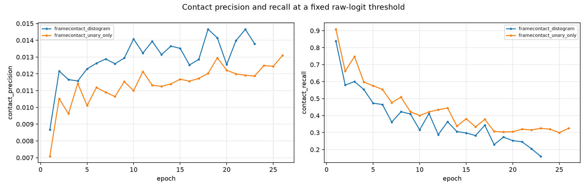
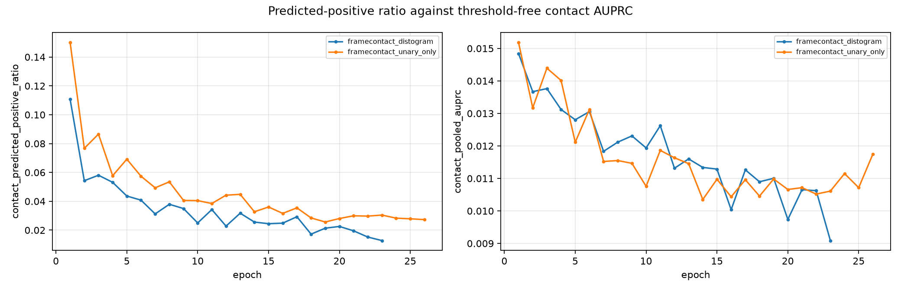

# FrameContact architecture decision report

Matched epoch: 21. Seeds: 17, 42, 73, 101, 137.

Development validation only. No SAbDab2 frozen test or AsEP official test was read. Comparisons are pinned to a common epoch and are refused unless exactly one registered factor differs.

## Main table

| Arm | Residue head | Pair target | Triangle | Gauge | Contrastive | Seeds | contact_pooled_auprc | contact_p_at_lmin_over_10 | contact_precision | contact_recall | contact_predicted_positive_ratio | epitope_pooled_auprc | epitope_precision | epitope_recall | paratope_pooled_auprc | paratope_precision | paratope_recall | partner_margin_worst_direction | partner_specific_variance_share | epitope_gate_applied | contact_brier | contact_ece_15 |
|---|---|---|---|---|---|---|---|---|---|---|---|---|---|---|---|---|---|---|---|---|---|---|
| `framecontact_distogram` | gated_hybrid | distogram | off | raw | off | 5 | 0.0107 | 0.0294 | 0.0140 | 0.2457 | 0.0195 | 0.1255 | 0.1448 | 0.2452 | 0.6556 | 0.5502 | 0.7617 | 0.0037 | n/a | n/a | 0.0146 | 0.0272 |
| `framecontact_unary_only` | unary | binary_contact | off | raw | off | 5 | 0.0107 | 0.0316 | 0.0120 | 0.3200 | 0.0299 | 0.1224 | 0.1352 | 0.1771 | 0.6848 | 0.5266 | 0.8343 | -0.0039 | n/a | n/a | 0.0218 | 0.0412 |

## Decision chain

### phase_1_residue_aggregation

How should epitope and paratope be produced: from the single-chain head alone, from the contact map alone, or from a gated combination -- and does routing through the identifiable partner-specific channel change the answer?

Not evaluable: no candidate arm has runs yet; expected any of framecontact_contact_marginal, framecontact_contact_hybrid, framecontact_gauge_marginal, framecontact_gauge_hybrid

### phase_1b_residue_partner_supervision

Does supervising partner specificity at labelled interface residues, rather than through one score per complex, produce partner-dependent residue predictions?

Not evaluable: baseline arm framecontact_gauge_hybrid has no runs

### phase_2_pair_target

Holding the residue head fixed, is a single distogram a better pair target than a binary contact head?

Not evaluable: baseline arm framecontact_contact_hybrid has no runs

### phase_3_triangle

Holding the pair target fixed, does the localized triangle constraint raise precision at a fixed budget while retaining recall?

Not evaluable: no candidate arm has runs yet; expected any of framecontact_distogram_triangle

### phase_4_fusion_depth

Only after the head, pair target, and geometry constraint are settled: late or every-layer interleaved cross-attention?

Not evaluable: baseline arm framecontact_contact_hybrid has no runs

## Metric stability audit

epoch_noise is the mean within-run standard deviation of the metric over the trailing 5 epochs. When it exceeds the metric's own value, single-epoch readings of that metric are not interpretable.

| Arm | Metric | Value at epoch | Epoch noise | Noise exceeds value |
|---|---|---|---|---|
| `framecontact_distogram` | partner_margin_worst_direction | +0.003682 | 0.012115 | YES |
| `framecontact_distogram` | contact_pooled_auprc | +0.010654 | 0.000882 | no |
| `framecontact_distogram` | contact_p_at_lmin_over_10 | +0.029384 | 0.003148 | no |
| `framecontact_distogram` | epitope_pooled_auprc | +0.125494 | 0.003425 | no |
| `framecontact_distogram` | paratope_pooled_auprc | +0.655600 | 0.013999 | no |
| `framecontact_unary_only` | partner_margin_worst_direction | -0.003884 | 0.012182 | YES |
| `framecontact_unary_only` | contact_pooled_auprc | +0.010716 | 0.000724 | no |
| `framecontact_unary_only` | contact_p_at_lmin_over_10 | +0.031643 | 0.004079 | no |
| `framecontact_unary_only` | epitope_pooled_auprc | +0.122409 | 0.003243 | no |
| `framecontact_unary_only` | paratope_pooled_auprc | +0.684774 | 0.007008 | no |

## Figures

## Warnings

- missing log tmp/live-logs-20260802/fc-res-head-1345042_5.out
- missing log tmp/live-logs-20260802/fc-res-head-1345042_6.out
- missing log tmp/live-logs-20260802/fc-res-head-1345042_7.out
- missing log tmp/live-logs-20260802/fc-res-head-1345042_8.out
- missing log tmp/live-logs-20260802/fc-res-head-1345042_9.out
- missing log tmp/live-logs-20260802/fc-res-head-1345042_10.out
- missing log tmp/live-logs-20260802/fc-res-head-1345042_11.out
- missing log tmp/live-logs-20260802/fc-res-head-1345042_12.out
- missing log tmp/live-logs-20260802/fc-res-head-1345042_13.out
- missing log tmp/live-logs-20260802/fc-res-head-1345042_14.out
- missing log tmp/live-logs-20260802/fc-distogram-1345108_5.out
- missing log tmp/live-logs-20260802/fc-distogram-1345108_6.out
- missing log tmp/live-logs-20260802/fc-distogram-1345108_7.out
- missing log tmp/live-logs-20260802/fc-distogram-1345108_8.out
- missing log tmp/live-logs-20260802/fc-distogram-1345108_9.out
