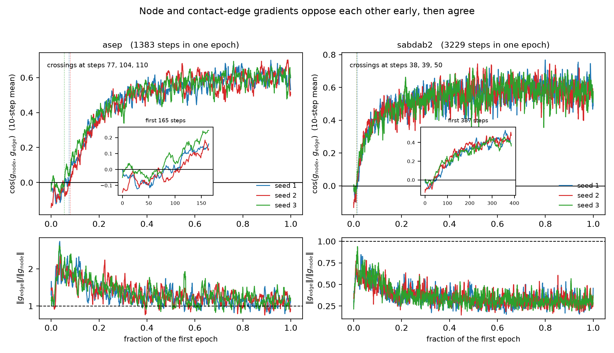

# The conflict is real, and it lasts about a hundred steps

Registered in `protocols/GRADIENT_ALIGNMENT_DYNAMICS_V1.md` and its two
amendments, which fixed the endpoint, the crossing rule and all four possible
verdicts before any trace was written.

**Complete: both cohorts, both toolchains, twelve runs.** Every one is a
transient.

## What was contradictory

The cosine between the node and contact-edge gradients on the shared trunk read
**+0.70** at converged checkpoints and **−0.059** in a smoke run — both on
**AsEP**. (An earlier version of this file said the +0.70 was sabdab2. It was
not; the run config reads `interaction_first_asep`. So there was never a
cohort question in the reconciliation, only a stage one.) Two
explanations for that were proposed and both were wrong: it was blamed on the
partner-ranking term, which turned out to be 23-40× too small to matter, and
then on training stage measured in epochs, which the epoch-wise trajectories
refuted by reading +0.468 in epoch one.

The smoke was capped at 40 training instances against a split of 1383. It was
never an epoch. It was the **first 40 optimisation steps**.

## The trace

One epoch, full data, three seeds, per-step geometry.

| seed | steps 1-10 | steps 1-40 | last 40 | negative steps | crossing |
|---|---|---|---|---|---|
| 1 | −0.041 | −0.069 | +0.579 | 78 / 1383 | step 104 |
| 2 | −0.130 | −0.075 | +0.616 | 91 / 1383 | step 110 |
| 3 | +0.012 | −0.007 | +0.580 | 53 / 1383 | step 77 |

**Verdict: transient.** Every seed opens with a negative mean cosine and crosses
to a durably positive one — a step after which the smoothed cosine never returns
below zero — inside the first 8% of the first epoch. The registered rule allows
up to 25%.

The two figures that appeared to contradict each other are both correct and both
incomplete. A 40-step window sits inside the transient. A converged checkpoint
sits four hundred thousand steps past it.

## Both cohorts

| cohort | steps in an epoch | crossings | as a fraction of the epoch |
|---|---|---|---|
| AsEP | 1383 | 104, 110, 77 | 5.6% – 8.0% |
| sabdab2 | 3229 | 50, 39, 38 | 1.2% – 1.5% |

Every seed of both cohorts opens with a negative mean cosine and crosses to a
durably positive one. sabdab2 crosses sooner, both absolutely and relative to its
longer epoch. The transient is not a property of one cohort.

## The toolchain replication

The same six runs on a different stack: torch 2.11+cu128 on sm_120 against
2.4.1+cu121 on sm_89, sharing almost no kernels.

| | 4090 crossing | 5090 crossing |
|---|---|---|
| AsEP seed 1 | 104 | 104 |
| AsEP seed 2 | 110 | 110 |
| AsEP seed 3 | 77 | 77 |
| sabdab2 seed 1 | 50 | 48 |
| sabdab2 seed 2 | 39 | 40 |
| sabdab2 seed 3 | 38 | 35 |

The opening means agree to four decimals and the first twenty steps agree to
three. The late-epoch means drift apart slightly (+0.6156 against +0.6106),
which is what accumulated float32 divergence over 1383 steps looks like.

A sign this close to zero is exactly what a numerical artefact could
manufacture. Two toolchains agreeing on where it flips is the evidence that it
does not.

## The norm ratio points opposite ways in the two cohorts

The lower panels of the figure are `‖g_edge‖ / ‖g_node‖` on the same axis as the
cosine. They do not agree:

| cohort | ratio, settled | reading |
|---|---|---|
| AsEP | ~1.1 – 1.3 | the contact-edge gradient is the larger one |
| sabdab2 | **~0.3** | the contact-edge gradient is about a third of the node gradient |

`results/gradient_conflict_v1/` reports 1.37 – 1.50 at converged AsEP
checkpoints, consistent with the AsEP panel. But the account built on it — that
the relational term takes too large a step in a shared direction — is an **AsEP**
observation. By the same measure on sabdab2 the relational term takes a much
smaller step than the node term, and "over-steps" is the wrong word there.

Both cohorts still show the transient, so the sign story generalises across these
two and the magnitude story does not. Any statement about loss scale must name
its cohort.

## What may be said

That gradient measurements taken at convergence can conceal conflict that
occurred during learning. On this cohort, the node and contact-edge objectives
oppose each other for roughly a hundred steps and agree strongly thereafter, and
a measurement at either end alone would report the opposite of the other.

## What may not

Not that the transient causes anything. It is a description of optimisation
geometry, and nothing here shows that a downstream quantity depends on it.

Not that it generalises beyond these two cohorts and this architecture. Two
cohorts agreeing is not a family of models agreeing.

Not that loss-scale imbalance follows from it. The gradient norm ratio settles
above one on AsEP and near a third on sabdab2, so the magnitude account does not
survive the second cohort even though the sign account does.

Not that this settles the mechanism behind the pair-supervision effect. The
`results/gradient_conflict_v1/` figure keeps its numbers and its narrowed scope —
node against contact edges, at convergence, on sabdab2 — and the claim that
gradient conflict is ruled out stays unavailable, since it was a claim about a
trajectory made from its endpoint.
