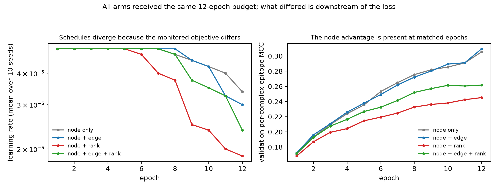

# What the four arms actually differed in

The ablation's arms are supposed to differ in two loss weights. They differ in
more than that, and the difference has to be stated before the result is
interpreted.

## `selection_metric` drives three things, not one

```python
validation_metric = validation_metrics[args.selection_metric]
scheduler.step(validation_metric)                        # ReduceLROnPlateau
improved = validation_metric < best_validation - args.min_delta   # checkpoint
epochs_without_improvement = 0 if improved else + 1      # early stopping
```

All four arms set `selection_metric = total`. But `total` is the weighted sum of
whichever terms an arm enables, so **the four arms monitor four different
quantities under one name**, and that quantity steers the learning-rate
schedule, the checkpoint choice and the stopping counter.

## What differed, read from the forty run histories

| arm | epochs run | selected epoch | LR reductions | final LR |
|---|---|---|---|---|
| node only | 12.0 ± 0.00 | 7.8 ± 2.27 | 0.7 | 3.38e−05 |
| node + edge | 12.0 ± 0.00 | 7.3 ± 1.62 | 0.8 | 3.00e−05 |
| node + rank | 12.0 ± 0.00 | **4.0 ± 1.10** | **1.5** | **1.88e−05** |
| node + edge + rank | 12.0 ± 0.00 | 6.1 ± 1.45 | 1.1 | 2.38e−05 |

Everything declared is identical apart from the two weights: same
`selection_metric` string, same negative sampling (4 from a pool of 64), same
budget.

**The training budget is not a confound**: every arm ran all twelve epochs, so
no arm was stopped early relative to another.

**The schedule and the selection point are.** `node + rank` plateaus fastest and
ends at half the learning rate of `node only`. For the comparison that carries
the result — `node + edge` against the full objective — the selected epoch is
7.3 against 6.1 and the learning rate ends at 3.00e−05 against 2.38e−05.

## The fixed-epoch sensitivity check

Every arm ran the full budget, so the contrast can be taken at a common epoch,
which holds the selection point constant. It does not hold the schedule
constant, because the schedules diverged on the way there.

`node + edge` minus `node + edge + rank`, node MCC, paired by seed:

| epoch | 1 | 2 | 3 | 4 | 6 | 8 | 10 | 12 |
|---|---|---|---|---|---|---|---|---|
| mean Δ | +0.0007 | +0.0033 | +0.0031 | +0.0095 | +0.0167 | +0.0202 | +0.0280 | +0.0479 |
| seeds up | 9/10 | 10/10 | 8/10 | 10/10 | 10/10 | 9/10 | 10/10 | 10/10 |
| verdict | better | better | **undecided** | better | better | better | better | better |

**The advantage is present at every common epoch and widens monotonically**, and
is decided at eleven of the twelve. It is therefore not an artefact of the arms
selecting different epochs.

### And it appears before either arm's schedule moves

`ReduceLROnPlateau` had not fired in **either** arm, in **any** seed, through
epoch 7: every run of `node + edge` and of `node + edge + rank` is still at its
initial learning rate for the first seven epochs. The earliest reduction in any
seed is epoch 9 for `node + edge` and epoch 8 for the full objective.

Within that window the learning rates are identical, and the advantage is
already there:

| epoch | 1 | 2 | 3 | 4 | 5 | 6 | 7 |
|---|---|---|---|---|---|---|---|
| mean Δ node MCC | +0.0007 | +0.0033 | +0.0031 | +0.0095 | +0.0109 | +0.0167 | +0.0204 |
| verdict | better | better | undecided | better | better | better | better |

So the schedule confound does not apply to the first seven epochs, and the
effect is established there — six of seven decided, growing thirtyfold across the
window. What differs in that window is the objective and the trajectory it
produces, not the learning rate and not the selected epoch.



Per-epoch node MCC also shows where each arm ends up: `node only` and
`node + edge` climb to ≈0.31 by epoch 12, the full objective stalls at ≈0.26,
and `node + rank` plateaus at ≈0.245.

## What may be claimed

> **In this training and selection procedure, disabling the ranking auxiliary
> term improved both prediction endpoints.**

That is a complete-pipeline intervention: it includes the term's effect on the
schedule and on which epoch is chosen, because those are downstream of the term
and were not held fixed.

## What may not

Not that the ranking **gradient** causes the harm. The fixed-epoch check removes
the selection confound, and the first seven epochs remove the schedule confound,
but the loss term still shapes the whole optimisation trajectory in every other
way — no experiment here isolates the gradient from the optimiser state it
accumulates into, or from paths outside the shared trunk.

Not that a small trunk gradient rules the term out either — that inference was
made earlier in this project and is withdrawn. Updates pass through AdamW's
first and second moments, so a short-window gradient norm on the shared trunk
does not bound a term's long-run effect on the parameters, let alone through
paths outside the trunk.

The honest form: the ablation locates the term, the run contract says what the
ablation contains, and the first-order trunk diagnostics do not account for it.

Reproduce with `scripts/audit_run_contract.py` and
`scripts/fixed_epoch_sensitivity.py`.
